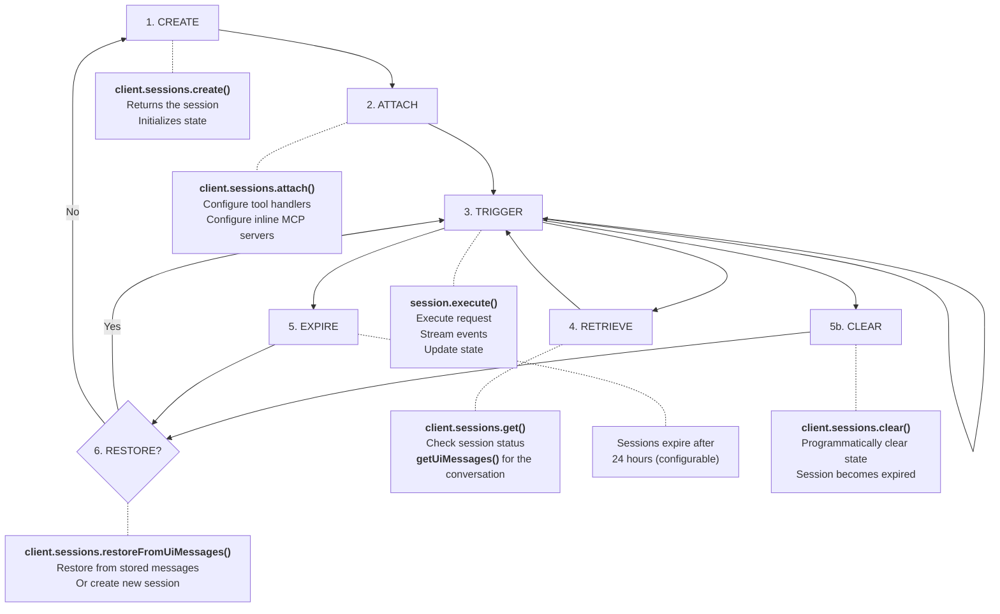

# Sessions

Sessions represent conversations with an agent. They store conversation history and the agent's variables, and enable stateful interactions.

## Creating Sessions

Create a session by specifying the agent ID and initial input variables:

```typescript
import { OctavusClient } from '@octavus/server-sdk';

const client = new OctavusClient({
  baseUrl: process.env.OCTAVUS_API_URL!,
  apiKey: process.env.OCTAVUS_API_KEY!,
});

// Create a session with the support-chat agent
const { id: sessionId } = await client.sessions.create('support-chat', {
  COMPANY_NAME: 'Acme Corp',
  PRODUCT_NAME: 'Widget Pro',
  USER_ID: 'user-123', // Optional inputs
});

console.log('Session created:', sessionId);
```

## Create and Trigger in One Call

`create()` followed by `attach().execute()` is two round trips, and it forces you to create the session before you know whether the user will ever send a message. `sessions.start()` does both in a single streaming request: it creates the session **and** runs its first trigger, so per-session configuration (model, system-prompt inputs, anything routed through session `input`) is captured at the moment of the first message, and no session is created for a conversation that never starts.

```typescript
import { toSSEStream } from '@octavus/server-sdk';

export async function POST(request: Request) {
  const { chatId, message, model } = await request.json();

  // No session exists yet. The first execute() creates it and runs the trigger.
  const session = client.sessions.start({
    agentId: 'support-chat',
    input: { COMPANY_NAME: 'Acme Corp', MODEL: model }, // captured now, not earlier
    idempotencyKey: chatId, // a retry resolves to the same session
    onSessionCreated: (sessionId) => {
      // Persist your own mapping so later messages attach to this session.
      void db.chats.update({ where: { id: chatId }, data: { sessionId } });
    },
  });

  const events = session.execute(
    { type: 'trigger', triggerName: 'user-message', input: { USER_MESSAGE: message } },
    { signal: request.signal },
  );

  return new Response(toSSEStream(events), {
    headers: { 'Content-Type': 'text/event-stream' },
  });
}
```

After the first trigger, the handle behaves exactly like one from `attach()` - continuations and later triggers automatically target the now-created session. Calling `execute()` with a `continue` request before the first trigger throws, since there is no session to continue yet.

### Learning the session id

The created session id reaches you through two channels:

- **`onSessionCreated(sessionId)`** - fired as soon as the id is known, before events stream. This is the ergonomic way to persist your chat-to-session mapping.
- **The first `start` event** - carries `sessionId`, which the client SDK also surfaces (see [Client SDK Overview](/docs/client-sdk/overview)). Useful when the browser needs the id, or for transports that do not expose response headers.

`getSessionId()` returns `undefined` on a deferred handle until the first trigger creates the session, then returns the id.

### Retry safety

`start()` sends an `idempotencyKey` (auto-generated if you omit it) as the `Idempotency-Key` header of the request that creates the session. A transient retry of the first request resolves to the same session instead of creating a duplicate or double-counting session usage, and runs its trigger on that session, so it is safe to retry. Using a stable, meaningful key such as your `chatId` guarantees one session per chat even across retries or double submits. A key is 1-255 printable ASCII characters with no spaces.

### Start Options

| Option             | Type                          | Description                                                                                        |
| ------------------ | ----------------------------- | -------------------------------------------------------------------------------------------------- |
| `agentId`          | `string`                      | Agent to start a session for                                                                       |
| `input`            | `Record<string, unknown>`     | Immutable session input, captured at the first trigger                                             |
| `idempotencyKey`   | `string`                      | Sent as the `Idempotency-Key` header: a retried start resolves to the same session; auto-generated |
| `onSessionCreated` | `(sessionId: string) => void` | Called with the session id as soon as it is assigned                                               |

`start()` also accepts the same `tools`, `mcpServers`, `onToolResults`, and `rejectClientToolCalls` options as `attach()`.

> Both flows are fully supported: `create()` + `attach()` when you need the session up front, `start()` when creation can wait for the first message.

## Getting Session Messages

To restore a conversation on page load, use `getUiMessages()` to retrieve the conversation as UI-ready messages:

```typescript
const messages = await client.sessions.getUiMessages(sessionId);

console.log(messages.length); // UIMessage[] ready for frontend
```

The returned messages can be passed directly to the client SDK's `initialMessages` option. An expired session has no messages (an empty array); read the session's `status` with `get()` to tell the two apart.

## The Session

`get()` returns the session: the agent it belongs to, when it was created, and whether its state is still `active` or has `expired`. `create()`, `restoreFromUiMessages()`, and `clear()` return the same shape.

```typescript
const session = await client.sessions.get(sessionId);

console.log({
  id: session.id,
  agentId: session.agentId,
  status: session.status, // 'active' | 'expired'
  createdAt: session.createdAt,
});
```

```typescript
interface Session {
  id: string;
  agentId: string;
  status: 'active' | 'expired';
  createdAt: string; // ISO 8601
}
```

The conversation itself is read with `getUiMessages()`; the full execution record (every tool call, model request, and error) with `getLogs()`.

## Getting Execution Logs

`getLogs()` returns the chronological execution trace for a session - triggers, messages, tool calls, LLM responses, model request markers, per-step token stats, errors, and other events emitted while the agent ran. Useful for debugging, observability, and building custom timeline views. See [Debugging](/docs/server-sdk/debugging) for what the model telemetry entries contain.

```typescript
const { entries } = await client.sessions.getLogs(sessionId);

for (const entry of entries) {
  console.log(entry.type, entry.timestamp);
}
```

Each entry is a typed variant of `ExecutionLogEntry` (a discriminated union) so consumers can narrow on `entry.type`:

```typescript
const { entries } = await client.sessions.getLogs(sessionId);

const toolCalls = entries.filter((e) => e.type === 'tool-call');
for (const call of toolCalls) {
  // call.toolName, call.toolArguments are typed without optional chaining
  console.log(call.toolName, call.toolArguments);
}
```

An expired session has no log: `entries` is empty and `total` is 0.

### Excluding Model Request Payloads

Every provider call logs a `model-request` entry. By default it is a lightweight marker (request timing, provider, and model); with [model request tracing](/docs/server-sdk/debugging#model-request-tracing) enabled it also carries the full provider request body and can be large. Pass `excludeModelRequests: true` to skip these entries:

```typescript
const result = await client.sessions.getLogs(sessionId, {
  excludeModelRequests: true,
});
```

### Truncation

Responses are capped at 3000 entries (most recent). When the log exceeds that cap, the response includes `total` and `truncated` so consumers can detect this:

```typescript
const logs = await client.sessions.getLogs(sessionId);

if (logs.truncated) {
  console.warn(`Showing latest 3000 of ${logs.total} entries`);
}
```

### Response Type

```typescript
interface ExecutionLogs {
  entries: ExecutionLogEntry[];
  total: number; // the number of entries on the server
  truncated: boolean; // true when only the most recent entries were returned
}
```

> **Forward-compatible types**: `ExecutionLogEntry` may gain new variants over time. Include a `default` case when switching on `entry.type` so unknown variants are handled gracefully.

## Attaching to Sessions

To trigger actions on a session, you need to attach to it first:

```typescript
const session = client.sessions.attach(sessionId, {
  tools: {
    // Tool handlers (see Tools documentation)
  },
});
```

### Attach Options

| Option                  | Type                                       | Description                                                                     |
| ----------------------- | ------------------------------------------ | ------------------------------------------------------------------------------- |
| `tools`                 | `ToolHandlers`                             | Server-side tool handler functions                                              |
| `mcpServers`            | `InlineMcpServer[]`                        | Inline MCP servers providing namespaced, typed tool groups                      |
| `onToolResults`         | `(results: ToolResult[]) => Promise<void>` | Callback invoked after server-side tool results are produced                    |
| `rejectClientToolCalls` | `boolean`                                  | If `true`, reject tool calls that have no server handler (no client forwarding) |

For MCP tool integration (browser, filesystem, shell via `@octavus/computer`), register dynamic tools after attaching with `session.setDynamicTools()`. See [Computer](/docs/server-sdk/computer) for details.

## Executing Requests

Once attached, execute requests on the session using `execute()`:

```typescript
import { toSSEStream } from '@octavus/server-sdk';

// execute() handles both triggers and client tool continuations
const events = session.execute(
  { type: 'trigger', triggerName: 'user-message', input: { USER_MESSAGE: 'Hello!' } },
  { signal: request.signal },
);

// Convert to SSE stream for HTTP responses
return new Response(toSSEStream(events), {
  headers: { 'Content-Type': 'text/event-stream' },
});
```

### Request Types

The `execute()` method accepts a discriminated union:

```typescript
type SessionRequest = TriggerRequest | ContinueRequest;

// Start a new conversation turn
interface TriggerRequest {
  type: 'trigger';
  triggerName: string;
  input?: Record<string, unknown>;
  rollbackAfterMessageId?: string | null; // For retry: truncate messages after this ID
  sender?: UIMessageSender; // Author of this turn, for multi-user attribution
  userMessageId?: string; // The id the runtime gives this turn's user message
}

// Continue after client-side tool handling
interface ContinueRequest {
  type: 'continue';
  executionId: string;
  toolResults: ToolResult[];
}
```

This makes it easy to pass requests through from the client:

```typescript
// Simple passthrough from HTTP request body
export async function POST(request: Request) {
  const body = await request.json();
  const { sessionId, ...payload } = body;

  const session = client.sessions.attach(sessionId, {
    tools: {
      /* ... */
    },
  });
  const events = session.execute(payload, { signal: request.signal });

  return new Response(toSSEStream(events));
}
```

### Attributing Messages in Multi-User Chats

When several people share one conversation, set `sender` on the trigger so each user message is attributed to its author. Set it **server-side from your authenticated user** - never trust a client-supplied identity:

```typescript
interface UIMessageSender {
  id?: string;
  name?: string;
  image?: string; // Avatar URL
}

export async function POST(request: Request) {
  const user = await authenticate(request); // your auth
  const { sessionId, ...payload } = await request.json();

  const session = client.sessions.attach(sessionId, {
    tools: {
      /* ... */
    },
  });
  const events = session.execute(
    {
      ...payload,
      sender: { id: user.id, name: user.name, image: user.avatarUrl },
    },
    { signal: request.signal },
  );

  return new Response(toSSEStream(events));
}
```

The runtime stamps the sender onto the user message it creates, so it comes back on `UIMessage.sender` from `getUiMessages()` and survives restore. `sender` is turn metadata - it is never added to your protocol's trigger `input`, and agent-initiated turns (no `sender`) stay unattributed. For instant optimistic display in the browser, also pass it on the client `send()` (see [Client SDK Messages](/docs/client-sdk/messages)).

### Keying the User Message

If you render the user's message before the turn runs (an optimistic bubble, a message stored in your own database), set `userMessageId` on the trigger and the runtime persists the turn's user message under that id. The message you rendered and the message `getUiMessages()` returns are then one message, with one id - no reconciliation by position or timestamp when the conversation is restored:

```typescript
const userMessageId = crypto.randomUUID(); // minted where the message is first shown

const events = session.execute(
  {
    type: 'trigger',
    triggerName: 'user-message',
    input: { USER_MESSAGE: text },
    sender: { id: user.id, name: user.name },
    userMessageId,
  },
  { signal: request.signal },
);
```

The id goes to the first visible user message the handler adds to the main thread. It is applied only when no message in the session has it yet; otherwise the runtime mints an id as usual, so re-issuing a turn whose earlier attempt already persisted the message never overwrites history (a retry that rolls back with `rollbackAfterMessageId` frees the id and reuses it). Like `sender`, `userMessageId` is turn metadata, not a protocol input.

### Stop Support

Pass an abort signal to allow clients to stop generation:

```typescript
const events = session.execute(request, {
  signal: request.signal, // Forward the client's abort signal
});
```

When the client aborts the request, the signal propagates through to the LLM provider, stopping generation immediately. Any partial content is preserved.

### One Execution at a Time

A session runs at most one execution at a time. A trigger or continuation that arrives while another execution is still running waits briefly for it to finish (for example, an aborted run flushing its final state); if the session stays busy, the request is rejected with `429` and code `SESSION_BUSY`:

```json
{
  "error": "The session is busy with another run. Please try again in a moment.",
  "code": "SESSION_BUSY"
}
```

The response carries a `Retry-After` header, and the SDK retries 429s automatically, so a transient overlap resolves on its own. If you see persistent `SESSION_BUSY` errors, your application is sending concurrent requests to one session - serialize them (one turn at a time per session), or use separate sessions for independent conversations.

## WebSocket Handling

For WebSocket integrations, use `handleSocketMessage()` which manages abort controller lifecycle internally:

```typescript
import type { SocketMessage } from '@octavus/server-sdk';

// In your socket handler
conn.on('data', async (rawData: string) => {
  const msg = JSON.parse(rawData);

  if (msg.type === 'trigger' || msg.type === 'continue' || msg.type === 'stop') {
    await session.handleSocketMessage(msg as SocketMessage, {
      onEvent: (event) => conn.write(JSON.stringify(event)),
      onFinish: async () => {
        // Fetch and persist messages to your database for restoration
      },
    });
  }
});
```

The `handleSocketMessage()` method:

- Handles `trigger`, `continue`, and `stop` messages
- Automatically aborts previous requests when a new one arrives
- Streams events via the `onEvent` callback
- Calls `onFinish` after streaming completes (not called if aborted)

See [Socket Chat Example](/docs/examples/socket-chat) for a complete implementation.

## Session Lifecycle



## Session Expiration

Sessions expire after a period of inactivity (default: 24 hours). `get()` tells you whether a session's state is still there:

```typescript
const session = await client.sessions.get(sessionId);

if (session.status === 'expired') {
  // Session has expired - restore or create new
  console.log('Session expired:', session.id);
} else {
  // Session is active
  const messages = await client.sessions.getUiMessages(sessionId);
  console.log('Messages:', messages.length);
}
```

A trigger on an expired session fails with `409` and the code `SESSION_EXPIRED` (`SESSION_EXPIRED_CODE`), never `404`, so a session you cleared or that aged out is told apart from one that does not exist; restore it first, or create a new one.

## Persisting Chat History

To enable session restoration, store the chat messages in your own database after each interaction:

```typescript
// After each trigger completes, save messages
const messages = await client.sessions.getUiMessages(sessionId);

await db.chats.update({
  where: { id: chatId },
  data: {
    sessionId,
    messages, // Store UIMessage[] as JSON
  },
});
```

> **Store the full `UIMessage[]` array.** It preserves every message part (text, tool calls, files, and so on) the restore rebuilds from.

The messages carry what their [display modes](/docs/protocol/tools#display-modes) revealed, and a restore rebuilds the model's history from exactly that: a `stream` tool call comes back with its arguments and result; a `title` call comes back with empty arguments and a placeholder where its result was, so the model knows the tool ran and nothing more; a `hidden` call is not in the messages and is gone. The same holds for a sub-agent: a streamed one comes back with its output, a `title` one without it, and a hidden one is gone. Set `display: stream` on the tools and workers whose results the model should still have after a restore.

## Restoring Sessions

When a user returns to your app:

```typescript
// 1. Load stored data from your database
const chat = await db.chats.findUnique({ where: { id: chatId } });

// 2. Check if session is still active
const session = await client.sessions.get(chat.sessionId);

if (session.status === 'active') {
  // Session is active - use it directly
  return {
    sessionId: session.id,
    messages: await client.sessions.getUiMessages(session.id),
  };
}

// 3. Session expired - restore from stored messages
if (chat.messages && chat.messages.length > 0) {
  const restored = await client.sessions.restoreFromUiMessages(
    chat.sessionId,
    chat.messages,
    { COMPANY_NAME: 'Acme Corp' }, // Optional: same input as create()
  );

  // The session is active again
  return {
    sessionId: restored.id,
    messages: chat.messages,
  };
}

// 4. Nothing to restore from - create new session
const created = await client.sessions.create('support-chat', {
  COMPANY_NAME: 'Acme Corp',
});

return {
  sessionId: created.id,
  messages: [],
};
```

`restoreFromUiMessages()` returns the session, `active` again; a session whose state was still live is returned as it is.

## Complete Example

Here's a complete session management flow:

```typescript
import { OctavusClient } from '@octavus/server-sdk';

const client = new OctavusClient({
  baseUrl: process.env.OCTAVUS_API_URL!,
  apiKey: process.env.OCTAVUS_API_KEY!,
});

async function getOrCreateSession(chatId: string, agentId: string, input: Record<string, unknown>) {
  // Load existing chat data
  const chat = await db.chats.findUnique({ where: { id: chatId } });

  if (chat?.sessionId) {
    // Check session status
    const session = await client.sessions.get(chat.sessionId);

    if (session.status === 'active') {
      const messages = await client.sessions.getUiMessages(session.id);
      return { sessionId: session.id, messages };
    }

    // Restore the expired session from the stored messages
    if (chat.messages?.length > 0) {
      const restored = await client.sessions.restoreFromUiMessages(
        chat.sessionId,
        chat.messages,
        input,
      );
      return { sessionId: restored.id, messages: chat.messages };
    }
  }

  // Create new session
  const { id: sessionId } = await client.sessions.create(agentId, input);

  // Save to database
  await db.chats.upsert({
    where: { id: chatId },
    create: { id: chatId, sessionId, messages: [] },
    update: { sessionId, messages: [] },
  });

  return { sessionId, messages: [] };
}
```

## Clearing Sessions

To programmatically clear a session's state (e.g., for testing reset/restore flows), use `clear()`:

```typescript
const session = await client.sessions.clear(sessionId);
console.log(session.status); // 'expired'
```

After clearing, the session is `expired`. You can then restore it with `restoreFromUiMessages()` or create a new session.

This is idempotent - calling `clear()` on an already expired session succeeds without error.

## Error Handling

Every failed request throws an `OctavusError` - the same class the stream's `error` events are turned into - carrying the HTTP `status`, the platform's stable `code`, the classification (`errorType`), whether a retry can help, and the `requestId` to quote to support:

```typescript
import { OctavusError } from '@octavus/server-sdk';

try {
  const messages = await client.sessions.getUiMessages(sessionId);
} catch (error) {
  if (OctavusError.isInstance(error)) {
    if (error.status === 404) {
      // Session not found
      console.log('Session not found, create a new one');
    } else {
      console.error(
        `${error.code ?? error.errorType}: ${error.message} (request ${error.requestId})`,
      );
    }
  }
  throw error;
}
```

A validation failure (`400`) or an invalid agent definition (`422`) carries its structured `issues`; a `429` or `503` carries `retryAfter` in seconds. See [Error handling](/docs/client-sdk/error-handling) for the classification and the [API reference](/docs/api-reference/overview#errors) for the response body.
